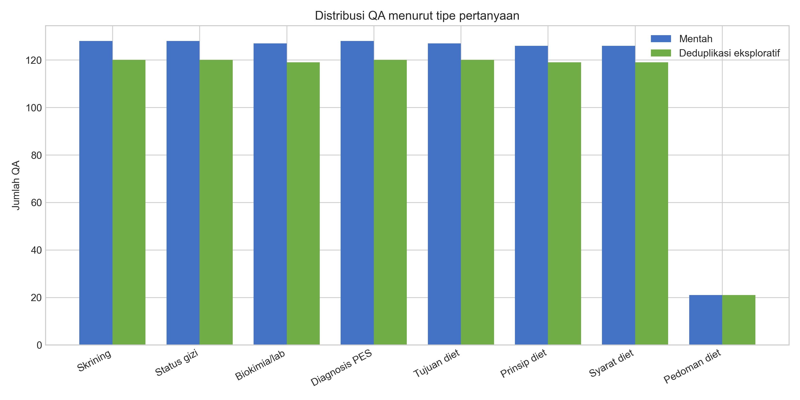
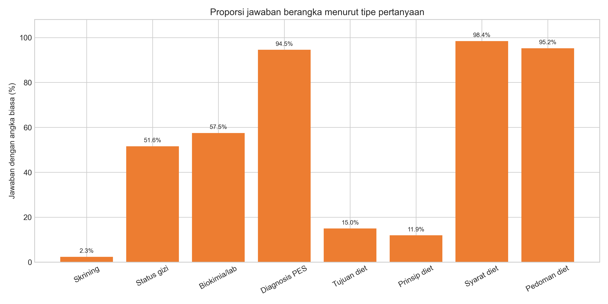
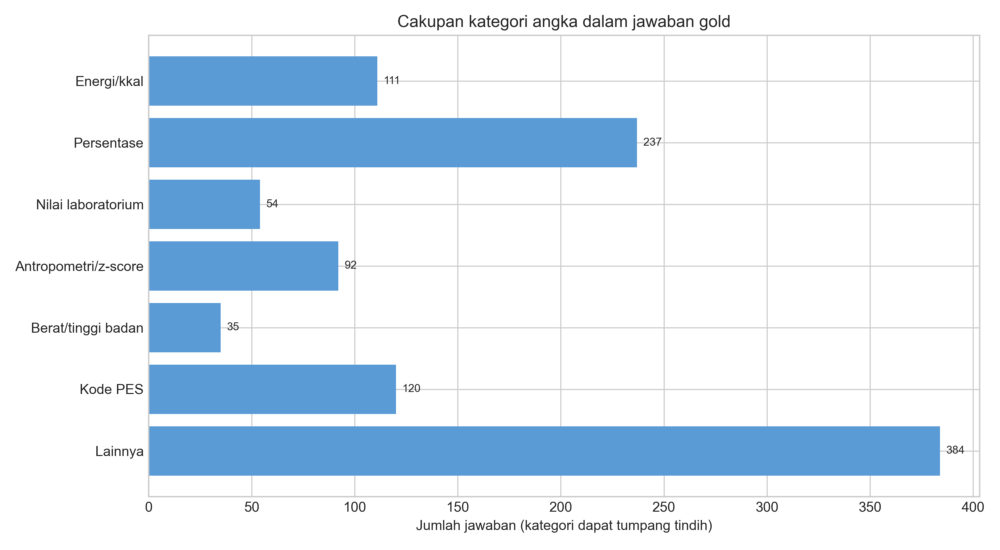

# Tahap 1 — Analisis Eksploratif Data

## Ruang lingkup dan prinsip

Analisis ini membaca data mentah secara *read-only*. Tidak ada split, data
olahan, atau perubahan label yang dibuat pada tahap ini. Seluruh statistik angka
bersifat eksploratif; parser angka tervalidasi, pengecualian nomor daftar/halaman,
dan keputusan normalisasi final baru ditetapkan pada Tahap 3.

- Seed contoh: `42`.
- SHA-256 `dataset.json`: `1a25866f2657d4840f4c19d5f1f2f969220a1fcc7ddb9d7454771b76797c0b2e`.
- SHA-256 manifest 120 file chunk: `ec15180142c4124ada4cde2bb3d78066059e85537fba1a97ca3191cf7c05c33e`.

## Statistik umum

| Ukuran | Nilai |
| --- | ---: |
| QA mentah | 911 |
| ID QA unik | 911 |
| Dokumen pada QA | 120 |
| File chunk | 120 |
| Total chunk | 13737 |
| Chunk per dokumen, minimum–rata-rata–maksimum | 32–114,47–256 |
| Template pertanyaan unik setelah normalisasi spasi/case | 8 |

Semua QA memiliki sepuluh field yang diharapkan dan tidak ada nilai wajib yang
kosong (`missing-field rows = 0`; `empty/null values =
0`). Semua 120 file chunk berupa list dengan total 13.737
record dan keyset konsisten: `chunk_index, page_number, pdf_name, text`.

### Distribusi tipe pertanyaan

| Tipe | QA mentah | Setelah dedup eksploratif | Memuat angka biasa | Memuat angka ≥2 digit |
| --- | --- | --- | --- | --- |
| Skrining | 128 | 120 | 3 (2,34%) | 1 (0,78%) |
| Status gizi | 128 | 120 | 66 (51,56%) | 50 (39,06%) |
| Biokimia/lab | 127 | 119 | 73 (57,48%) | 69 (54,33%) |
| Diagnosis PES | 128 | 120 | 121 (94,53%) | 116 (90,62%) |
| Tujuan diet | 127 | 120 | 19 (14,96%) | 6 (4,72%) |
| Prinsip diet | 126 | 119 | 15 (11,90%) | 7 (5,56%) |
| Syarat diet | 126 | 119 | 124 (98,41%) | 124 (98,41%) |
| Pedoman diet | 21 | 21 | 20 (95,24%) | 20 (95,24%) |

Pemetaan di atas bersifat deterministik karena data hanya memiliki delapan teks
pertanyaan unik. Label permanen akan ditulis ke data olahan pada Tahap 2.

### Panjang teks

| Komponen | Min | P25 | Median | Rata-rata | P75 | Maks |
| --- | --- | --- | --- | --- | --- | --- |
| Pertanyaan (kata) | 6 | 6,0 | 9,0 | 8,46 | 10,0 | 11 |
| Jawaban (kata) | 1 | 7,0 | 29,0 | 71,78 | 107,5 | 692 |
| Jawaban (karakter) | 3 | 49,0 | 212,0 | 498,53 | 780,5 | 4847 |
| Konteks gold (kata) | 8 | 124,0 | 142,0 | 130,70 | 151,0 | 192 |

## Audit kualitas data

### Rekonsiliasi dokumen dan chunk

- Nama mentah yang langsung cocok: **120/120**.
- Nama yang cocok setelah NFKC, konversi `#Uxxxx`, dan penghapusan U+2060:
  **120/120**.
- Nama yang memuat `#Uxxxx`: **0**; nama yang memuat U+2060:
  **1**. Snapshot ini sudah memakai nama Unicode yang sama di
  dataset dan disk, tetapi satu nama masih mengandung U+2060 pada kedua sisi.
- Join unik berdasarkan `(file, page_number, chunk_index)` berhasil untuk
  **911/911** QA dan tidak ada kunci ambigu
  (`0`).
- Isi `context` sama persis dengan teks chunk pada **899/911**
  QA; **12** QA memiliki perbedaan teks walaupun
  kunci chunk cocok. Tahap 2 harus menetapkan sumber konteks kanonik.

### Duplikasi

Terdapat **35** kelompok duplikat `(file, question)`:
17 kelompok berisi dua baris dan
18 kelompok berisi tiga baris. Ini menghasilkan
**53** baris berlebih, sehingga ukuran setelah deduplikasi
eksploratif *keep-first* adalah **858 QA**.

Hanya **4/35** kelompok memiliki
jawaban identik dan **7/35** memiliki
konteks identik. Karena mayoritas duplikat berbeda isi, *keep-first* di sini
hanya dipakai untuk menghitung ukuran sementara; aturan deduplikasi formal harus
didokumentasikan pada Tahap 2.

### `answer_start`

Dari 911 span jawaban, hanya **79
(8,67%)** yang cocok tepat dengan
`context`; **832** tidak cocok. Field ini
tidak layak digunakan sebagai lokasi jawaban, sesuai masalah data yang telah
diantisipasi.

## Fokus angka

### Definisi eksploratif

Parser sementara mengenali bilangan bulat, desimal titik/koma, pemisah ribuan
titik, tanda negatif, persen, dan kedua ujung rentang. Kode PES dimask dari
angka biasa dan dihitung terpisah. Ambiguitas seperti `1.500` sementara dianggap
ribuan, sedangkan `1.5` dianggap desimal; pengecualian nomor daftar, nomor
halaman, tahun sitasi, dan nomor bagian belum final.

- **441/911 (48,41%)**
  jawaban memuat sedikitnya satu angka biasa.
- **393/911
  (43,14%)** memuat token angka biasa
  dengan sedikitnya dua digit setelah kode PES dimask.
- Regex mentah `\d{2,}` tanpa parsing menemukan **402**
  jawaban. Tidak satu pun definisi eksploratif ini mereplikasi angka pendahuluan
  413 secara persis; perbedaan definisi akan diaudit pada Tahap 3, bukan
  disesuaikan agar cocok dengan target.
- Total angka biasa yang terdeteksi: **4830**; rata-rata seluruh
  QA **5,30**, median **0,0**,
  dan maksimum **96**. Di antara jawaban yang berangka,
  rata-ratanya **10,95** angka.
- Jawaban diagnosis PES dengan kode: **120/128
  (93,75%)**.

### Kategori angka

Kategori ditetapkan dengan aturan konteks lokal dan dapat muncul bersama dalam
satu jawaban. `Lainnya` mencakup usia, waktu, volume, gram zat gizi, rasio, tahun,
dan angka yang belum dapat diklasifikasikan dengan aman.

| Kategori | Token/kode | Jawaban | Contoh pendek (seed 42) |
| --- | --- | --- | --- |
| Energi/kkal | 188 | 111 | 1841,3 kkal/hari |
| Persentase | 987 | 237 | 54,7% |
| Nilai laboratorium | 225 | 54 | Hb 12,6 g/dl |
| Antropometri/z-score | 335 | 92 | BB/U < -3 SD |
| Berat/tinggi badan | 59 | 35 | Tinggi Badan : 125 cm |
| Kode PES | 464 | 120 | NB-1.1 |
| Lainnya | 3036 | 384 | usia 2 bulan |

Contoh hanya berupa fragmen pendek dari jawaban gold dan tidak memuat nama atau
identitas pasien. Pemilihan contoh dilakukan otomatis dengan seed 42 dari semua
fragmen yang cocok dengan pola berpresisi tinggi.

### Cakupan angka gold

Dengan toleransi sementara selisih absolut ≤0,01 atau relatif ≤0,5%:

| Ukuran | Hasil |
| --- | ---: |
| Kemunculan angka gold yang ada di seluruh laporan | 4800/4830 (99,38%) |
| Kemunculan angka gold yang ada di chunk gold | 3485/4830 (72,15%) |
| Jawaban berangka yang seluruh angkanya ada di laporan | 435/441 (98,64%) |
| Jawaban berangka yang seluruh angkanya ada di chunk gold | 232/441 (52,61%) |

Hasil laporan (**99,38%** dan
**98,64%**) konsisten dengan temuan
pendahuluan sekitar 99% dan 98%. Cakupan chunk gold
**72,15%** lebih rendah daripada perkiraan
awal sekitar 76% sebesar
3,85 poin
persentase. Kemungkinan penyebabnya meliputi definisi angka, perlakuan kode PES,
angka daftar/sitasi, dan 12 ketidaksesuaian konteks; semuanya harus diuji dengan
unit test dan audit contoh pada Tahap 3.

## Implikasi untuk tahap berikutnya

1. Seluruh dokumen dapat direkonsiliasi, tetapi nama tetap harus dinormalisasi
   agar U+2060 tidak menjadi identitas dokumen berbeda.
2. Deduplikasi tidak boleh diasumsikan sebagai salinan identik karena 31 dari 35
   kelompok mempunyai jawaban berbeda.
3. `answer_start` tidak digunakan pada pipeline.
4. Angka gold hampir selalu tersedia di laporan penuh, sedangkan banyak tidak
   tersedia di chunk gold; ini mendukung pengujian retrieval verifikasi tambahan.
5. Semua hasil angka pada bab ini bersifat eksploratif dan tidak menggantikan
   validasi Tahap 3.
